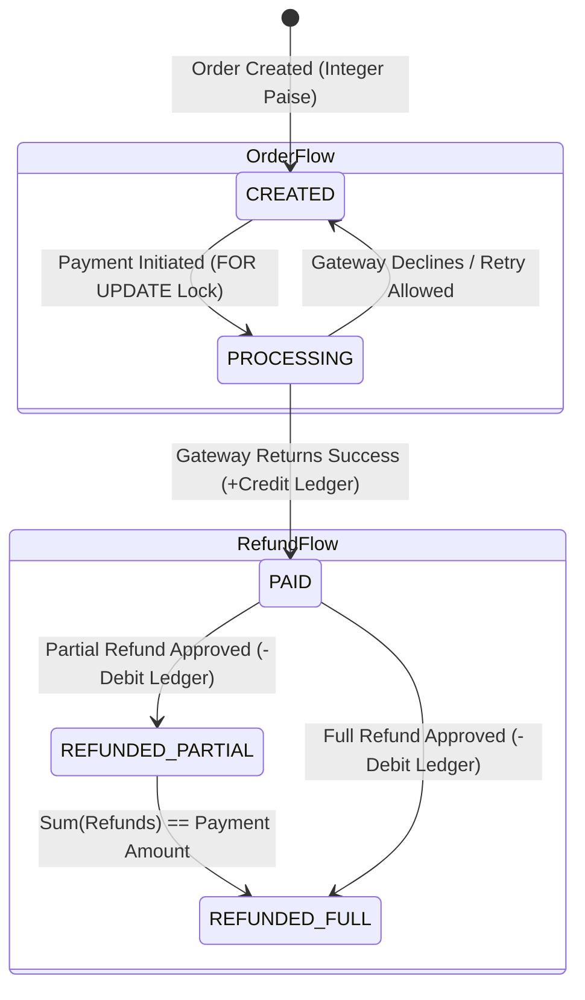

# 🛡️ FundRaksha: Production Payment Gateway & Settlement Core

[](https://www.typescriptlang.org/)
[](https://nodejs.org/)
[](https://www.postgresql.org/)
[](https://sequelize.org/)
[-brightgreen?logo=jest)](https://jestjs.io/)
[](http://localhost:3000/api-docs)
[](LICENSE)

A robust, multi-tenant **Payment Gateway Simulation & Transaction Settlement Engine** engineered with production-grade financial safeguards: **integer-paise monetary precision**, **pessimistic row-level locking (`SELECT ... FOR UPDATE`)**, **Strategy & Factory design patterns**, and an **immutable double-entry audit ledger**.

Designed to reflect the distributed payment rail orchestration used by tier-1 payment service providers (**Razorpay, Stripe, PhonePe, Adyen**).

---

## 📌 Executive Summary & Architecture

```
                    ┌────────────────────────────────────────────────────────┐
                    │               Client / Merchant Services               │
                    └───────────────────────────┬────────────────────────────┘
                                                │ REST API (JSON)
                                                ▼
                    ┌────────────────────────────────────────────────────────┐
                    │          Authentication & Governance Layer             │
                    │   • Dual Auth: JWT (Dashboard) / SHA-256 API Key (B2B) │
                    │   • Zod Schema Validation & UUID Parsing               │
                    │   • Correlation ID Tracing (AsyncLocalStorage)         │
                    └───────────────────────────┬────────────────────────────┘
                                                │
                                                ▼
                    ┌────────────────────────────────────────────────────────┐
                    │                     Service Layer                      │
                    │   • Sequelize ACID Transaction Orchestration           │
                    │   • Pessimistic Row Lock (Order Lock FOR UPDATE)       │
                    │   • Integer Paise Math (Floating-Point Drift Immunity) │
                    │   • Multi-Tenant Isolation Scoping                     │
                    └───────────────┬────────────────────────┬───────────────┘
                                    │                        │
                                    ▼                        ▼
     ┌──────────────────────────────────────────────┐ ┌──────────────────────────────┐
     │           Payment Processor Factory          │ │    Repository Persistence    │
     │   (Strategy Pattern Multi-Rail Engine)       │ │  • OrderRepository           │
     │   ├── CreditCardStrategy (Luhn, Brand, Edge) │ │  • PaymentRepository         │
     │   ├── UpiStrategy (NPCI RRN, VPA Check)      │ │  • RefundRepository          │
     │   ├── NetBankingStrategy (Bank Whitelisting) │ │  • LedgerRepository          │
     │   └── MockWalletStrategy (Prepaid Balance)   │ │  • MerchantRepository        │
     └──────────────────────────────────────────────┘ └──────────────┬───────────────┘
                                                                     │
                                                                     ▼
                                                      ┌──────────────────────────────┐
                                                      │  PostgreSQL Relational DB    │
                                                      └──────────────────────────────┘
```

---

## 💡 Core Engineering Decisions (The "Why")

### 1. Integer Paise Currency Precision (Eliminating IEEE 754 Floating Drift)
In JavaScript / Node.js, `0.1 + 0.2 === 0.30000000000000004`. In financial tech, storing currency as floating-point numbers causes accumulated ledger discrepancy and reconciliation failure.
- **Decision**: All amounts across the database (`orders`, `payments`, `refunds`, `merchants`, `ledger_entries`) are strictly stored as **64-bit BigInt / Integer Paise** (`1 INR = 100 Paise`).
- **Utility**: All inputs and outputs interface via verified conversion utils (`rupeesToPaise()` and `paiseToRupees()`).

### 2. Pessimistic Row Locking (`SELECT ... FOR UPDATE`) Against Race Conditions
Payment webhooks and customer double-clicks often trigger concurrent payment calls against the same order.
- **Why not Optimistic Locking?** Optimistic version checks fail after strategy execution, meaning third-party money debits might succeed before the database conflicts.
- **Decision**: [PaymentService](src/services/payment.service.ts) acquires an exclusive database row lock on the target order record (`orderRepository.findById(orderId, { lock: transaction.LOCK.UPDATE }, transaction)`).
- **Outcome**: The secondary concurrent request blocks on PostgreSQL until the primary transaction commits or rolls back, immediately detecting that the order is already `PAID` $\rightarrow$ returns clean `409 ConflictError`.

### 3. Open/Closed Principle via Strategy + Factory Patterns
Payment methods (Credit Cards, UPI, NetBanking, Wallets) have distinct validation rules, brand identification, and bank-rail behaviors.
- **Anti-Pattern avoided**: Sprawling `switch(method)` blocks embedded in service logic.
- **Decision**: Every payment rail implements the polymorphic `PaymentStrategy` interface. The `PaymentProcessorFactory` caches singleton strategy instances and resolves them in $\mathcal{O}(1)$ time. Adding a new payment method (e.g., *Crypto, BNPL, e-RUPI*) requires zero modification to [PaymentService](src/services/payment.service.ts).

### 4. Double-Entry Audit Ledger & Financial Invariant
Financial integrity demands that merchant account balances can never be updated without an immutable, auditable proof.
- **Decision**: Every balance increase (`CREDIT`) or decrease (`DEBIT`) creates an append-only row in `ledger_entries` within the **exact same database transaction**.
- **Invariant**: $\text{Balance}_{\text{new}} = \text{Balance}_{\text{old}} \pm \text{Amount}_{\text{txn}}$. Any transaction failure triggers an immediate DB rollback.

### 5. Multi-Tenant Zero-Trust Authentication
- **Dual Auth Paths**:
  - `JWT (HMAC-SHA256)`: Short-lived authentication for dashboard operations (`/auth/login`, `/merchants/me`).
  - `API Key (SHA-256)`: Secret keys with high entropy prefixed with `pk_live_...`. The raw key is exposed **only once** at creation; the database stores only the one-way `sha256(rawKey)`.
- **Tenant Scoping**: All queries require explicit merchant scoping (`WHERE merchant_id = :reqMerchantId`), guaranteeing complete data isolation.

---

## 🔄 State Machine & Transaction Lifecycle



- **Refund Solvency Guarantee**:
  $$\text{Refund Allowed If: } \text{Requested Amount} \le (\text{Payment Amount} - \sum \text{Prior Refunds}) \quad \mathbf{\text{AND}} \quad \text{Merchant Balance} \ge \text{Requested Amount}$$

---

## 🚀 API Endpoint Reference

All endpoints are documented interactively via OpenAPI / Swagger UI at `/api-docs`.

| Method | Endpoint | Auth | Purpose | Status Codes |
| :--- | :--- | :--- | :--- | :--- |
| `POST` | `/api/v1/auth/register` | Public | Register new merchant organization | `201`, `400`, `409` |
| `POST` | `/api/v1/auth/login` | Public | Authenticate merchant & obtain JWT | `200`, `401` |
| `POST` | `/api/v1/merchants/api-keys`| Bearer JWT | Generate B2B API Key (`pk_live_...`) | `201`, `401` |
| `GET` | `/api/v1/merchants/me` | Bearer JWT | Fetch balance & active API key prefixes | `200`, `401` |
| `GET` | `/api/v1/merchants/ledger` | Bearer JWT | Fetch immutable audit ledger logs | `200`, `401` |
| `POST` | `/api/v1/orders` | API Key / JWT | Create an order with integer paise | `201`, `400`, `409` |
| `GET` | `/api/v1/orders/:id` | API Key / JWT | Get order details & payment history | `200`, `404` |
| `GET` | `/api/v1/orders` | API Key / JWT | List all orders for the merchant | `200` |
| `POST` | `/api/v1/payments` | API Key / JWT | Process payment via Strategy Pattern | `200`, `400`, `402`, `409` |
| `GET` | `/api/v1/payments/:id` | API Key / JWT | Query payment record details | `200`, `404` |
| `GET` | `/api/v1/payments/:id/status` | API Key / JWT | Poll payment execution status | `200`, `404` |
| `POST` | `/api/v1/refunds` | API Key / JWT | Issue full or partial refund | `201`, `400`, `404` |
| `GET` | `/api/v1/refunds/:id` | API Key / JWT | Query refund transaction record | `200`, `404` |

---

## 🧪 Testing Suite & Verification

The project includes unit tests for all strategy modules and end-to-end integration tests over Express and Sequelize transactions.

```bash
# Run unit & integration test suite
npm test
```

### Test Suite Results:
```text
PASS tests/integration/api.test.ts
  Payment Gateway End-to-End API Integration Tests
    POST /api/v1/auth/register
      ✓ should register a new merchant and return JWT (193 ms)
      ✓ should fail with 400 on invalid email (29 ms)
    POST /api/v1/auth/login
      ✓ should authenticate merchant and return JWT (15 ms)
    POST /api/v1/merchants/api-keys
      ✓ should generate a secret API Key for merchant (16 ms)
      ✓ should fail with 401 when JWT is missing (30 ms)
    POST /api/v1/orders
      ✓ should create an order using API Key authentication (17 ms)
    POST /api/v1/payments
      ✓ should process payment successfully and update order status to PAID (14 ms)
    POST /api/v1/refunds
      ✓ should process refund and debit merchant balance (12 ms)
      ✓ should fail with 400 when refund amount exceeds payment amount (23 ms)

PASS tests/unit/paymentStrategy.test.ts
  Payment Strategy & Factory Unit Tests
    PaymentProcessorFactory
      ✓ should return CreditCardStrategy for CREDIT_CARD method (1 ms)
      ✓ should return UpiStrategy for UPI method (1 ms)
      ✓ should return NetBankingStrategy for NETBANKING method (1 ms)
      ✓ should return MockWalletStrategy for MOCK_WALLET method (1 ms)
      ✓ should throw BadRequestError for invalid payment method (3 ms)
    CreditCardStrategy
      ✓ should successfully process valid card payment (2 ms)
      ✓ should fail if card ends with 0000 (4 ms)
      ✓ should fail if card number is too short (1 ms)
    UpiStrategy
      ✓ should successfully process valid UPI payment (2 ms)
      ✓ should fail if UPI VPA format is invalid (1 ms)
    NetBankingStrategy
      ✓ should successfully process supported bank (1 ms)
      ✓ should fail for unsupported bank code (1 ms)

Test Suites: 2 passed, 2 total
Tests:       21 passed, 21 total
```

---

## 🛠️ Local Development Setup

### 1. Prerequisites
- **Node.js**: v18.x or v20.x
- **PostgreSQL**: v14+ running locally (or via Docker)

### 2. Installation
```bash
git clone https://github.com/singhsanket143/Express-Typescript-Starter-Project.git fundraksha
cd fundraksha
npm install
```

### 3. Environment Configuration
Create a `.env` file in the root directory:
```env
PORT=3000
NODE_ENV=development
DB_HOST=localhost
DB_PORT=5432
DB_USER=postgres
DB_PASSWORD=your_password
DB_NAME=fundraksha_db
JWT_SECRET=super_secret_jwt_key_for_development
JWT_EXPIRES_IN=24h
```

### 4. Database Setup & Migrations
```bash
# Run database migrations
npm run migrate
```

### 5. Start Development Server
```bash
npm run dev
```

Server boots at `http://localhost:3000`. Access Swagger UI at `http://localhost:3000/api-docs`.

---

## 📂 Project Directory Structure

```text
src/
├── config/                  # Centralized configuration & environment loader
├── database/                # Sequelize ORM models & database connector
│   └── models/              # Merchant, ApiKey, Order, Payment, Refund, LedgerEntry
├── middlewares/             # Auth (JWT & API Key), Zod validation, Error & Correlation IDs
├── repositories/            # Repository pattern abstracting Sequelize persistence
├── routers/                 # Modular Express v1 & v2 routers
├── services/                # Core business orchestration & database transactions
├── shared/                  # Domain errors & Integer Paise money utilities
├── strategies/              # Strategy Pattern payment processors (Card, UPI, NetBanking, Wallet)
├── validators/              # Zod input schemas for validation
├── app.ts                   # Express server definition & Swagger docs mounting
└── server.ts                # Application entrypoint & graceful shutdown
```

---

## 📄 License
This project is licensed under the ISC License.